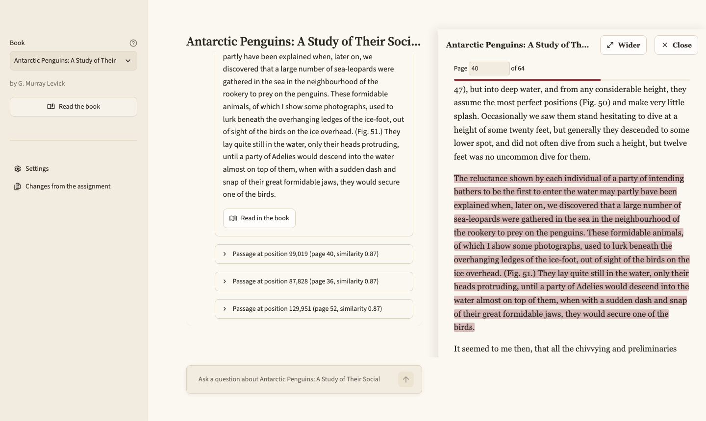
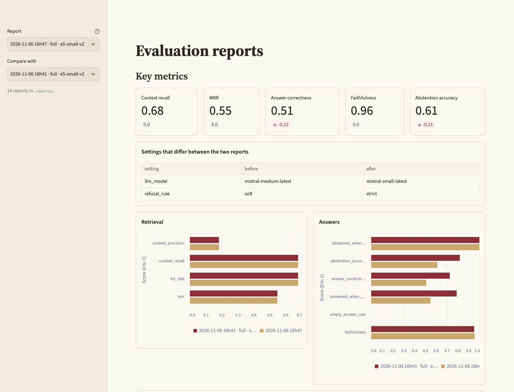
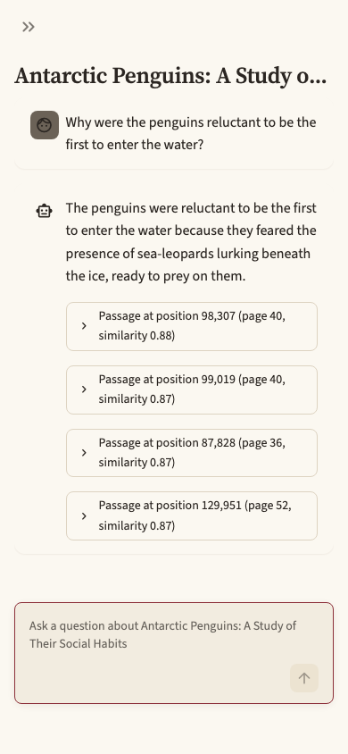
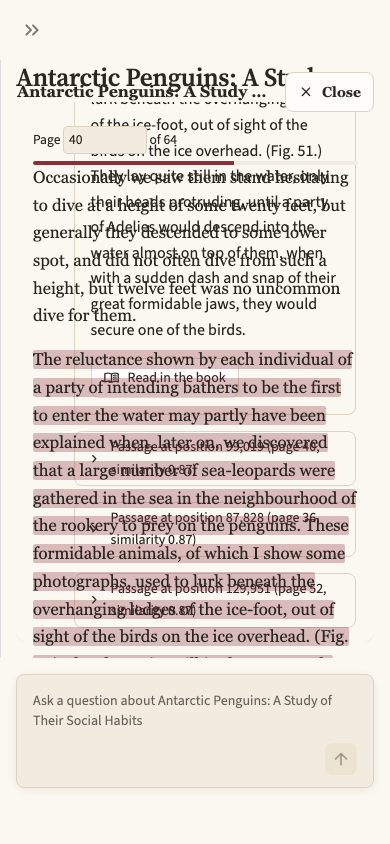

# Book RAG: a reading companion with measured retrieval

Ask questions about eight books from Project Gutenberg. Every answer comes with the passages it is based on, and a click opens the book at
that passage. The project is a reference for a **retrieval-augmented chat** (RAG) that is **evaluated**, not just demonstrated: every
choice below was compared with numbers on held-out questions.

<p align="center">
  
</p>

## What it shows

| Topic | What is in the repo |
| :-- | :-- |
| **RAG** | Clean text, chunk 1000/200 characters, embed, retrieve the top 4 passages with their similarity, answer only from them (`src/book_rag/rag.py`) |
| **Vector database** | [Chroma](https://www.trychroma.com/), one collection per book. Its name carries a fingerprint of the model, the chunk settings and the text, so a change builds a fresh store; ids are hashes of the chunk text (`store.py`) |
| **LLM chat** | Mistral (or Groq) answers; chat memory of 2 exchanges plus a rolling summary; a 200-word book summary for whole-book questions; an optional agent that searches again (`conversation.py`, `memory.py`, `agent.py`) |
| **Evaluation** | 72 golden questions with a held-out split, retrieval metrics (recall, MRR), answer metrics with an LLM judge, reports and a dashboard (`evals/`, `src/book_rag/evaluation/`) |
| **Comparisons** | 25+ retrieval variants (MiniLM, e5, bge, hybrid, reranker, HyDE, clustering ...) and 4 answer setups, with what did not work |
| **Embedding improvements** | `all-MiniLM-L6-v2` to `e5-small-v2` with `query:`/`passage:` prefixes: MRR 0.29 to 0.56 |
| **Reading the source** | A reader with highlighted passages, pages and "ask about this selection" (custom Streamlit components, tested in a real browser) |

## Results

Penguin book, 72 questions (21 `dev`, used for tuning; 51 `test`, never used for tuning). `mistral-small` answers, `mistral-large` judges.

| Setup | Correctness (test) | Abstention accuracy | Calls per question |
| :-- | --: | --: | --: |
| Strict refusal rule (the assignment's prompt) | 0.50 | 0.61 | 1.0 |
| **Soft refusal rule (default)** | **0.69** | 0.79 | 1.0 |
| Agent that searches again (off by default) | 0.68 | 0.85 | 1.7 to 3.2 |

The prompt, not the retrieval, was the largest gain; the agent costs calls and adds nothing on held-out facts. Retrieval: context recall
0.67 to 0.71, MRR 0.55. Details, rejected ideas and limits: [docs/changes.md](docs/changes.md). Metrics and method: [evals/README.md](evals/README.md).

<p align="center">
  
</p>

## Quick start

```bash
uv sync
cp .env.example .env              # add MISTRAL_API_KEY (or set BOOK_RAG_LLM=groq and GROQ_API_KEY)
uv run streamlit run streamlit_app.py      # the chat
uv run streamlit run streamlit_reports.py  # the evaluation dashboard
uv run book-rag                            # the same in the terminal
uv run book-rag-eval                       # evaluate (add --retrieval-only to skip the language model)
```

`make app | reports | eval | test | lint | screenshots` are shortcuts. `BOOK_RAG_OFFLINE=1` replaces the language model by a fixed reply
(no key, no cost). The first question about a book builds its vector store (a few seconds); the embedding model is downloaded once.

## On a phone

The sidebar folds away and the book opens full screen under the header.

<p align="center">
  
  
</p>

## Layout

```
streamlit_app.py       entry point: navigation, sidebar
app_pages/             chat, settings, changes pages (+ chat.css)
streamlit_reports.py   dashboard of the evaluation reports
src/book_rag/          the package: books, store, rag, agent, memory, conversation, llm, reader, selection, cli
src/book_rag/evaluation/   metrics, judge, dataset, compare, run (book-rag-eval)
evals/                 golden questions (dataset.json), reports, method
data/                  the eight books and their summaries
tests/                 unit, app, browser (Playwright) and live tests
docs/                  changes from the assignment, the agent log, images
assignment/            the original notebook and README this project started from
scripts/               screenshots
```

## Development

```bash
make lint                                         # ruff
make test                                         # about 430 unit and app tests, a few seconds
uv run playwright install chromium && uv run pytest -m browser   # browser tests, about 2 minutes
BOOK_RAG_LIVE=1 uv run pytest -m live             # calls the real model
```

Open work is in [TODO.md](TODO.md). The original assignment is in [assignment/](assignment/README.md).
